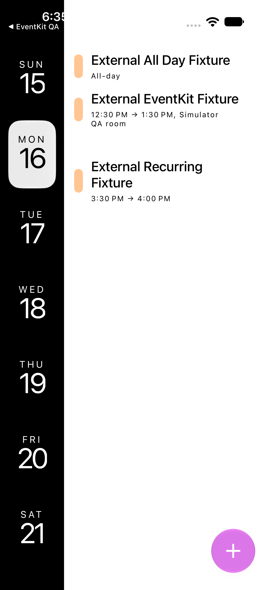
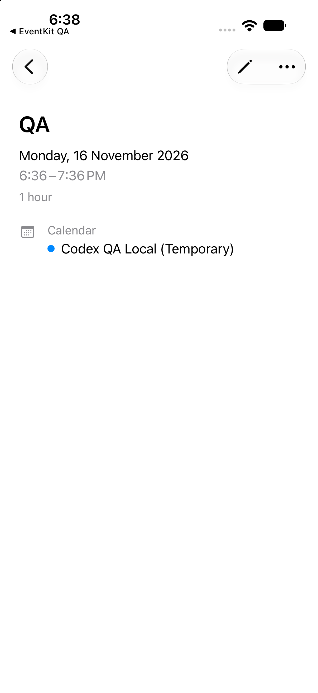

# calendar reimagined

**ai-assisted with codex**

an iphone calendar built with swiftui and eventkit. pick a day on the left, see its events on the right, and open an event to edit it.

## demo

the screenshots and recording use fictional events.

the video shows the app in a mac catalyst preview.

| agenda | event |
| --- | --- |
|  |  |

https://github.com/user-attachments/assets/35371aaa-9c67-41fd-9162-081af687130a

[watch the screen recording](docs/media/demo.mp4)

## using it

- tap or drag along the date rail to select a day. swipe across it to change weeks.
- tap the plus button to add an event. choose its calendar, dates, location, notes, and colour.
- open an event to edit it, copy its details, share it, or delete it.
- timed, overnight, and all-day events appear on the days they cover. changes from apple calendar show up while the app is open.

events save to the calendars already set up on your iphone. allow full calendar access when asked. if you deny access, use the app's settings button to enable it later. adding events also requires a writable calendar in the calendar app.

## sideloading

requires an iphone running ios 27 or later and a mac or windows computer. download `calendarreimagined-unsigned.ipa` from the [latest release](https://github.com/kevinsstinc/calendar-remade/releases/latest). altserver signs it with your apple account during installation.

1. install and set up altserver. windows also needs the itunes and icloud versions listed in its guide. follow the official [macos guide](https://faq.altstore.io/altstore-classic/how-to-install-altstore-macos) or [windows guide](https://faq.altstore.io/altstore-classic/how-to-install-altstore-windows).
2. connect your iphone by usb, unlock it, and trust the computer.
3. hold option on macos or shift on windows while clicking the altserver icon. choose `sideload .ipa…`, select your iphone and the downloaded ipa, and sign in when prompted. [altserver instructions](https://faq.altstore.io/release-notes/altserver#direct-ipa-sideloading)
4. trust your developer account under settings → general → vpn & device management. enable developer mode under settings → privacy & security, restart, and confirm it after restarting. [developer mode guide](https://developer.apple.com/documentation/xcode/enabling-developer-mode-on-a-device)

with a free apple account, repeat the sideload before seven days pass. altstore classic can manage refreshes through altserver over usb or the same wi-fi network. [refreshing apps](https://faq.altstore.io/altstore-classic/your-altstore), [connecting to altserver](https://faq.altstore.io/altstore-classic/altserver)

## running from source

1. open `calendarreimagined.xcodeproj` in xcode with the ios 27 sdk installed.
2. select the `calendarreimagined` scheme and an iphone simulator or connected iphone running ios 27 or later.
3. select your signing team if running on a physical iphone, then run the app.

the app uses a light appearance. read-only calendars can be viewed. edits and deletes to recurring events affect the selected occurrence. custom event colours and events saved by older local-only versions stay in the app.

## ai use

codex helped implement and refactor the eventkit integration, verify builds, and prepare the release.
